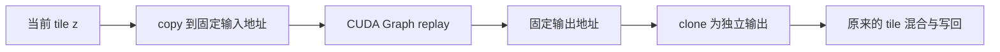

# MiniMax-H3 fused VAE + CUDA Graph：代码导读

这是个人 fork 的学习实验，基于上游 `65699fe94c355e235f1acabddd866bce0bba1c02`。
保留已验证实验的 copy/replay/clone 流程和首次调用检查，把公共 runner 从历史 encoder 脚本中提取出来。
新增显式开关及配置检查，未改写官方融合 kernel。当前提交不包含 encoder graph、音频 graph、RoPE lifetime fix 或实验 profiler hook。

## 从哪几处开始读

| 代码 | 作用 |
| --- | --- |
| [`vae.py`](../../vllm_omni/diffusion/models/minimax_h3/vae.py) 文件末尾 | 默认关闭的实验入口；每个 worker 导入时检查环境变量 |
| [`fused_vae_graph.py`](../../vllm_omni/diffusion/models/minimax_h3/experimental/fused_vae_graph.py) 的 `prepare_video` | 检查 resident TP1/fused 配置，缓存固定 mask，将单个 tile 的 `model.decode` 换成 runner |
| [`graph_runner.py`](../../vllm_omni/diffusion/models/minimax_h3/experimental/graph_runner.py) 的 `Runner.run` | 找 shape 缓存；首次分配静态输入、预热、capture、校验 |
| 同文件的 `Runner.replay` | 输入 copy → graph replay → 输出 clone，最核心的几行 |
| [`test_graph_runner.py`](../../examples/offline_inference/minimax_h3_fused_vae_graph/test_graph_runner.py) | 不加载权重的真实 CUDA 测试，以及合成 mask/适配层测试 |

建议先读 `replay`，再回到 `run`，最后看 VAE 是怎样接入的。runner 的 `[1]` 到 `[5]` 注释对应下面的步骤。

## CUDA Graph 录下的是什么

普通 PyTorch eager 执行时，CPU 逐步进入 Python、dispatcher、kernel launch，GPU 接收一个个操作。
如果 CPU 发射速度跟不上，GPU 可能等下一个 kernel，trace 上就能看到 bubble。
CUDA Graph 把一段 GPU 操作及其依赖录成可重放的图；下次 CPU 调用一次 `graph.replay()`，即可提交这组操作。
录制之后，replay 不再执行 tile 函数里的 Python 逻辑。

它不是 autograd 的求导图，也不是结果缓存。每个新输入仍会重新计算。
它也不会自动把多个 kernel 融成一个：融合减少操作/访存，graph 减少 CPU 发射负担，二者可以叠加。
本实验里 replay 的仍然是官方融合后的 QK/RoPE、SwiGLU、scaled residual 等 kernel。



## 第一次遇到一个 shape：分配、预热、capture

**[1] 静态输入。** `static = tree_map(... x.clone() ..., args)` 分配一组长期存活的输入 tensor。
GPU kernel 在 graph 里保留的是这些地址。之后传进来的 tile 可以是另一个 tensor，但 graph 不会自动改用它的新地址。
因此需要持有 `static`，每次把新值复制过去。

**[2] side-stream warmup。** 在辅助 stream 上先跑两次 `self.fn(*static)`。
这让 Triton 首次编译、懒初始化、attention metadata 建立等工作先发生。
`stream.wait_stream(current)` 与 `current.wait_stream(stream)` 建立前后依赖，避免辅助 stream 读到尚未完成的数据。
这里保留了实验中的同步以确认初始化完成；每次缓存命中的 tile replay 没有全设备同步。

**[3] capture。** `with torch.cuda.graph(graph, stream=stream, ...): output = self.fn(*static)` 进入录制模式。
Python 会在这个阶段执行，用来提交需要记录的 GPU 操作。以后 replay 时 Python tile 函数不执行。
PyTorch 管理 capture 所需的分配和 graph 私有内存池；我们长期持有 `(graph, static, output)`。
固定 kernel、地址和依赖可以重用，输入值则可以改变。

runner 按输入 shape、dtype、device 查缓存，本适配层只有一个 CUDA tensor 参数。
最多保留四个 graph entry；遇到更多 shape 时整批清空再录制，限制静态输入/输出和私有池的留存。
它不是用于任意 pytree/CPU 输入/动态控制流的通用库。

## 后续 tile：copy、replay、clone

**[4] copy/replay。** `dst.copy_(src)` 把当前 tile 的值写到捕获时用过的地址，随后 `graph.replay()`。
这两步在当前 stream 上保持顺序，GPU 会先完成 copy 再使用新数据。
shape 一样不意味着内容一样，所以绝不能省略 copy。
`replay()` 通常只提交工作；它返回不表示 GPU 已经完成计算。

**[5] 输出 clone。** capture 得到的 `output` 是长期复用的输出存储。
下一次 replay 会覆盖这块存储。若直接返回它，调用者保留的“上一块 tile”就可能被下一块悄悄改写。
而 checkpoint 的 tile 混合还可能原地修改返回值，所以这里 `clone()` 给调用者独立所有权。
clone 在 graph 外，和 replay 同 stream 排序；它有内存复制开销，不能假装是零成本。

这和昨晚的 compiled RoPE 问题有相同的生命周期要点：**值目前正确，不代表这块存储以后仍归你所有。**
RoPE fix 保护的是编译函数产出的中间 tensor；这里保护的是整个手动 graph 的 tile 输出。
本分支关闭 native RoPE compile，不应用那个 fix。

## 为什么只包住一个 tile

调用链仍是：`decode_latent → decode_base → 切 tile → model.decode(z) → 混合/写回 → 输出视频`。
我们只替换 `model.decode(z)`，即一个 tile 的 `post_quant_conv + decoder ViT`。
切块循环、latent 反归一化、拼接、uint8 写回和最终 shape 处理仍由原来的代码执行。
所以 tile 的 Python body 不再运行，外层 VAE 的 Python 仍会运行。

## attention mask 为什么需要单独处理

checkpoint 的 `_mask_mod_to_dense` 在建立 metadata 时有需要 CPU 参与的操作。
这样的工作不适合在 capture 中进行，例如读取 GPU tensor 的 `.item()` 会触发 CPU/GPU 同步。

适配层只缓存带 `block_sparse_cache_key` 的、由 shape 决定的不可变 mask。
key 包括 mask 的语义 key、batch、heads、q/kv length 和 device；不是按输入内容缓存结果。
side-stream warmup 先建立它，capture 时拿已准备好的 tensor。
没有可识别的 key，或者 capture 中发现 cache miss，就报错，避免录出不完整的图。
`aux_tensors` 存在时沿用原 mask 函数；这类路径不在当前 workload 的验证范围内。

## 首次验证和限制

保留了实验时的检查：每个新 shape 比较 eager 与 replay，改变输入内容后再次比较；首个完整 VAE 请求也在同一 latent 上比较两条路径。
`check` 对浮点使用容差，对 uint8 允许最大差 1 并另外记录 exact/max_abs；检查通过本身不等于逐像素完全一致。
已有 B300 实验记录的完整 uint8 输出是 exact、max_abs=0。
首次调用还会测时和写指标，因此不能拿它代表纯推理性能。
完整 `decode_latent` 包装保留实验测时所需的同步，也不是生产服务的最终实现。

当前范围：单实例、串行请求、TP1、常驻单 CUDA GPU、固定权重、eval/inference、官方 fused VAE 路径。
开关检查 native FF/RoPE compile 关闭；使用时必须关闭模型/组件 offload，不能在录图之后搬动权重或更新参数。
mask 包装和 `BYPASS` 是进程全局实验状态，不支持并发请求或多个 VAE 实例。
`capture_error_mode="thread_local"` 是 CUDA 捕获错误检查的范围，**不是并发安全保证**。
mask 缓存在这个固定 workload 中仅有少量项，未为无限变换 shape 的长期服务设计淘汰策略。

## 已有证据应该怎样理解

已有 B300 完整 workload：BS1、1 个去噪步、576×1024、24fps、目标 10s，实际 243 帧。
同进程首次校验中的 fused eager VAE 为 2.764446s，fused graph 为 2.687273s；两条路径各测一次。
约 2.8% 的差值未经显著性验证，不能声称稳定收益。
后续正常 run 的 video VAE 为 2.696283s；轻量 trace 中为 2.740884s，210 次 graph launch，VAE GPU busy 97.4%。
同 latent 的完整 VAE uint8 输出相同，正常 run/trace 的视频文件 hash 也相同。
这些结果属于提取前的完整实验，不是本整理提交又进行了一次 B300 测试。

整理后的本机 UT 在 RTX 3060 Laptop（SM86）、PyTorch 2.10.0+cu128、Triton 3.6.0 上 **10 项通过、无跳过**；Ruff 检查及格式检查通过。
重新运行真实融合 leaf kernel 和 graph，检查改变输入、旧输出存活、返回值原地修改、Python body 不重入，并观察真实 graph launch。
SM86 本地 leaf 测试直接调用官方 leaf，绕过硬件 dispatcher，不等于官方完整 VAE 支持 SM86。
合成适配层 UT 检查 mask 准备和外层 eager 边界，不代替 checkpoint 全模型验证。

## 如何启用

在启动服务前设置这些环境变量，让所有 worker 一起继承：

```bash
export MINIMAX_H3_EXPERIMENTAL_FUSED_VAE_GRAPH=1
export MINIMAX_H3_VAE_DECODER_VIT_FF_TORCH_COMPILE=0
export MINIMAX_H3_VAE_DECODER_VIT_ROPE_TORCH_COMPILE=0
export H3_VAE_GRAPH_DIR=/tmp/h3_vae_graph
```

随后使用原来的单卡、无 offload recipe。DiT 的 regional compile 和这个 VAE tile graph 是不同的范围。
首次 decode 建图并写 `component_graph_metrics.json`、`vae_graph_metrics.json`。
本提交没有接入原实验的 pipeline profiler hook；它不会自动导出全模型 trace。
恢复默认路径需在新进程中关闭实验开关；删除变量不能撤销已经执行过的 monkeypatch。

从仓库根目录，在有 PyTorch、Triton、pytest 和真实 CUDA 的环境运行无需权重的 UT：

```bash
python -m pytest -o addopts='' -q \
  examples/offline_inference/minimax_h3_fused_vae_graph/test_graph_runner.py
```

`addopts=''` 避免依赖整个仓库测试配置中的 xdist 等额外插件。测试产物写入 pytest 临时目录，不写进仓库。
